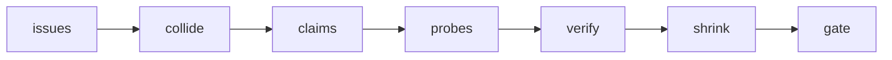

# bug-checkup

**Find the bugs where code breaks its own promise.**

<div align="center">

[](LICENSE)
[](https://www.python.org/)
[](#)
[](CHANGELOG.md)

</div>

Most bugs are not crashes. They are **stated contracts that quietly stop holding** — a codec that
claims to be lossless, a cache key that claims to be deterministic, a filter that claims to preserve
order. `bug-checkup` finds those: it extracts the contracts a codebase makes about itself, turns them
into executable probes, and reduces each failure to the smallest input that still reproduces.

It is the counterpart of [`cloudflare/security-audit-skill`](https://github.com/cloudflare/security-audit-skill):
that one audits trust boundaries, this one audits stated promises.

> [!NOTE]
> No package yet — clone the repo and run it with Python 3.10+. No dependencies, no API keys, no
> network calls in the core pipeline.

## Quickstart

```bash
git clone https://github.com/zhengqiuyang/bug-checkup.git
cd bug-checkup
python selftest.py                     # the tool tests itself; should print PASS

python run.py --help                   # every phase is one subcommand
python run.py claims <path/to/pkg> --name <owner>__<repo>
python run.py probe  <owner>__<repo> --python <repo venv python> --cwd <repo> --env PYTHONPATH=<repo>
```

Every run writes to `runs/<owner>__<repo>/`, with the same artifact names every time, so a run is
resumable and comparable across repos.

## How it works



- **issues** — list open issues and mark the unclaimed ones (no linked PR, no assignee, no comments).
- **collide** — before writing code: has someone already filed a PR for this? Checks the issue
  timeline, open/merged PR keywords, and whether an open PR touches the same file.
- **claims** — extract the contracts a codebase states about itself (12 families, tiered A/B).
- **probes** — executable scripts with an exit-code contract: `0` pass, `1` fail, `2` inconclusive,
  `3` checker bug. The runner never imports the audited code.
- **verify** — snapshot probe verdicts *before* the fix, re-run *after*; `fixed` / `still_failing` /
  `regressed`, and a non-zero exit unless the flip is clean.
- **shrink** — delta-debug a failing input down to the smallest value that still reproduces.
- **gate** — one command that reads every artifact and decides whether a finding is ready to publish.

## Commands

| Command | What it does |
|---|---|
| `issues` | open issues with linked PRs; marks unclaimed targets |
| `collide` | duplicate-PR gate (timeline + keywords + file-level, open and merged) |
| `claims` | contracts from docstrings/Markdown, tiered and ranked by visibility |
| `probe` / `new-probe` / `autoprobe` | run probes / scaffold one / auto-generate round-trip probes |
| `baseline` / `verify` | red-to-green loop with a machine-checkable delta |
| `shrink` | delta debugging for failing JSON inputs |
| `diff` | run one scenario against two versions, including `--pip-version` baselines |
| `examples` | run fenced documentation examples; classifies noise instead of reporting it |
| `callsites` | call sites, and options no caller ever passes (Python AST; TS name-based) |
| `gate` | single publish-readiness check over every artifact |

## Worked example

A real run against [`567-labs/instructor`](https://github.com/567-labs/instructor), an LLM
structured-output library. Its Anthropic image encoder emitted `{"source": {"data": None}}` for any
image without inline data — the provider rejects that payload.

```text
claims               5            # tier-A contracts after fixing package reachability
probes               6 (0 failing)
verification      fixed=1 still_failing=0 regressed=0
shrunk 360 -> 32 bytes            # {"source": "", "media_type": ""}
gate: PASS (1 warning)
```

The three new unit tests fail on the unpatched source and pass on the fix. The reduced input shows
the defect is *any image without data*, not just data URIs — which made both the issue and the patch
easier to review.

## Artifacts

```
runs/<owner>__<repo>/
  claims.json            # contracts: source line, tier, visibility, probes
  probes/                # one standalone script per claim
  probe-results.json     # verdicts + observed output
  probe-baseline.json    # snapshot taken before the fix
  verification.json      # fixed / still_failing / regressed
  shrink-results.json    # bytes before/after, candidates tried
  shrunk/*.min.json      # minimal reproductions
  diff-results.json      # per-input differences between two versions
  examples-results.json  # documentation examples, classified
  collision-results.json # why a target is or is not a duplicate
  issues-results.json    # unclaimed-issue scan
```

## What it is, and what it is not

| It is | It is not |
|---|---|
| A probe-driven evidence pipeline | An automatic bug finder |
| A duplicate-PR gate and an unclaimed-issue scanner | A security scanner or a linter |
| A red/green verifier for a suspected bug | A code review bot |
| A delta-debugger for failing inputs | A fuzzer |

> [!WARNING]
> The contract scan is heuristic. It surfaces candidates, not verdicts: on a mature codebase it may
> produce a handful of claims while the real bug needs a human to read the code. Treat `claims` as a
> map, not as coverage.

## Honest limits

- Probe generation beyond inverse function pairs is manual.
- `callsites` detects unwired options for Python only; TS/JS is name-based.
- `collide` speaks GitHub only.
- `trace` (attributing a failure to a line) and `report` (generating the write-up) are not
  implemented yet.
- No coverage-guided input generation.

## Docs

| File | Contents |
|---|---|
| [`SKILL.md`](SKILL.md) | agent-facing workflow, probe protocol and discipline |
| [`DESIGN.md`](DESIGN.md) | phases, decisions, anti-patterns |
| [`ECOSYSTEMS.md`](ECOSYSTEMS.md) | per-ecosystem methods and the compiled-artifact caveat |
| [`CHANGELOG.md`](CHANGELOG.md) | version history |

## Versioning

`VERSION` + `CHANGELOG.md`. Changing an artifact shape requires a minor bump and a migration note.

## License

MIT — see [`LICENSE`](LICENSE).
