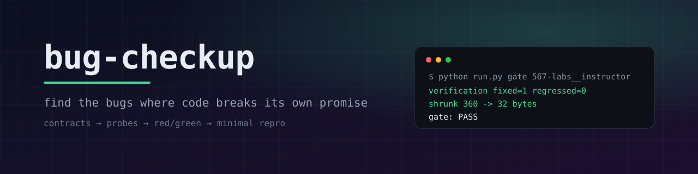
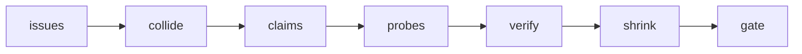

<div align="center">



**Find the bugs where code breaks its own promise.**

Probes, red/green evidence, and minimal reproductions — for the contract bugs that never crash.

[](CHANGELOG.md)
[](https://www.python.org/)
[](LICENSE)
[](#)
[](selftest.py)

</div>

<a id="quickstart"></a>

## Quickstart

```bash
git clone https://github.com/zhengqiuyang/bug-checkup.git
cd bug-checkup
python selftest.py                 # the tool tests itself; prints PASS

python run.py --help               # one subcommand per phase
python run.py claims path/to/pkg --name owner__repo
python run.py probe  owner__repo --python path/to/venv/python --cwd path/to/repo \
  --env PYTHONPATH=path/to/repo
```

> [!NOTE]
> Python 3.10+, standard library only, no API keys. Each run writes to `runs/<owner>__<repo>/`
> with the same artifact names every time, so runs are resumable and comparable.

## Why this exists

| The bug you keep finding | What this does about it |
|:--|:--|
| A codec "guarantees lossless" but a cell value changes type | Turns the sentence into a probe, then a failing repro |
| A cache key is "deterministic" until a dict reorders | Proves it red, patches it, proves it green |
| A filter "preserves order" only for well-behaved input | Shrinks the failing input to its minimal form |
| You fixed it — but can you show it? | `baseline` → `verify` emits a machine-checkable delta |
| Someone already opened the same PR | `collide` blocks the duplicate before you write code |

<details>
<summary><b>What it is / is not</b></summary>

| It is | It is not |
|:--|:--|
| A probe-driven evidence pipeline | An automatic bug finder |
| A duplicate-PR gate and unclaimed-issue scanner | A security scanner or linter |
| A red/green verifier for a suspected bug | A code review bot |
| A delta-debugger for failing inputs | A fuzzer |

Built as the contract-level counterpart of
[`cloudflare/security-audit-skill`](https://github.com/cloudflare/security-audit-skill):
that one audits trust boundaries, this one audits stated promises.

</details>

## How it works



| Step | Question it answers |
|:--|:--|
| `issues` | Are there unclaimed bugs left in this repo? |
| `collide` | Is someone already working on it? |
| `claims` | What does this code promise about itself? |
| `probes` | Does it actually keep that promise? |
| `verify` | Did the fix flip exactly the failing probe, with no regression? |
| `shrink` | What is the smallest input that still fails? |
| `gate` | Is this finding ready to publish? |

## Worked example

A real run against [`567-labs/instructor`](https://github.com/567-labs/instructor): its Anthropic
image encoder emitted `{"source": {"data": None}}` for any image without inline data, which the
provider rejects.

```text
claims               5            # tier-A contracts after fixing package reachability
probes               6 (0 failing)
verification      fixed=1 still_failing=0 regressed=0
shrunk 360 -> 32 bytes            # {"source": "", "media_type": ""}
gate: PASS (1 warning)
```

The three new unit tests fail on the unpatched source and pass on the fix. The reduced input shows
the defect is *any image without data*, not just data URIs — which made both the issue and the patch
easier to review.

<a id="commands"></a>

## Commands

<details>
<summary><b>All subcommands</b></summary>

| Command | What it does |
|:--|:--|
| `issues` | Open issues with linked PRs; marks unclaimed targets |
| `collide` | Duplicate-PR gate: timeline, keywords, file-level, open and merged |
| `claims` | Contracts from docstrings/Markdown, tiered and ranked |
| `probe` | Execute probes; exit code 0/1/2/3 becomes the verdict |
| `new-probe` | Scaffold a probe from a template |
| `autoprobe` | Generate round-trip probes for inverse function pairs |
| `baseline` / `verify` | Snapshot before, re-run after, report the delta |
| `shrink` | Delta-debug a failing JSON input to its minimal form |
| `diff` | One scenario, two versions, including `--pip-version` baselines |
| `examples` | Run documentation examples, classify the noise |
| `callsites` | Call sites; options no caller ever passes (Python AST) |
| `gate` | Publish-readiness check over every artifact |

</details>

<details>
<summary><b>Artifact layout</b></summary>

```text
runs/<owner>__<repo>/
  claims.json            # contracts: source line, tier, visibility, probe
  probes/                # one standalone script per claim
  probe-results.json     # verdicts + observed output
  probe-baseline.json    # snapshot taken before the fix
  verification.json      # fixed / still_failing / regressed
  shrink-results.json    # bytes before/after, candidates tried
  shrunk/*.min.json      # minimal reproductions
  diff-results.json      # per-input differences between two versions
  examples-results.json  # documentation examples, classified
  collision-results.json # why a target is or is not a duplicate
  issues-results.json    # unclaimed-issue scan
```

</details>

## Honest limits

> [!WARNING]
> The contract scan is heuristic. It surfaces candidates, not verdicts: on a mature codebase it may
> produce a handful of claims while the real bug still needs a human to read the code.

- Probe generation beyond inverse function pairs is manual.
- `callsites` detects unwired options for Python only; TS/JS is name-based.
- `collide` speaks GitHub only.
- `trace` (attributing a failure to a line) and `report` (generating the write-up) are not
  implemented yet.
- No coverage-guided input generation.

## Docs

| File | Contents |
|:--|:--|
| [`SKILL.md`](SKILL.md) | Agent-facing workflow, probe protocol, discipline |
| [`DESIGN.md`](DESIGN.md) | Phases, decisions, anti-patterns |
| [`ECOSYSTEMS.md`](ECOSYSTEMS.md) | Per-ecosystem methods, compiled-artifact caveat |
| [`CHANGELOG.md`](CHANGELOG.md) | Version history |

## License

MIT — see [`LICENSE`](LICENSE).
